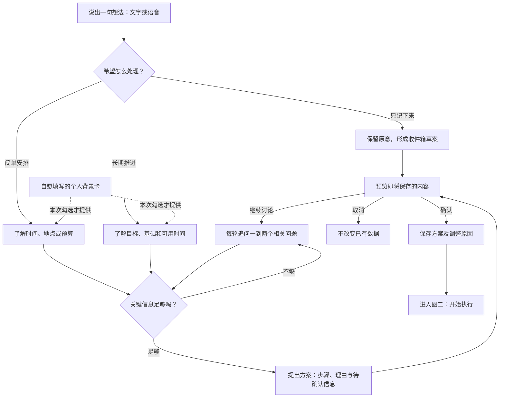
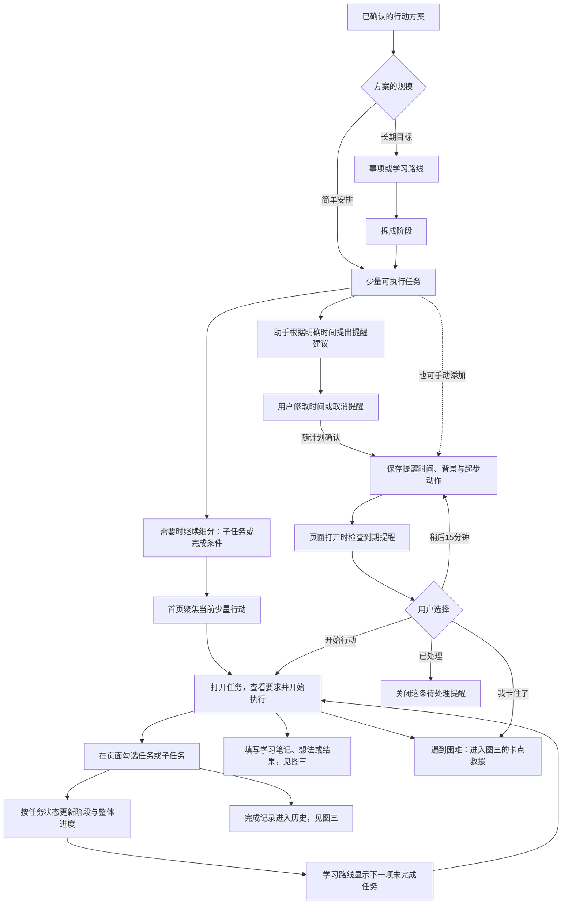
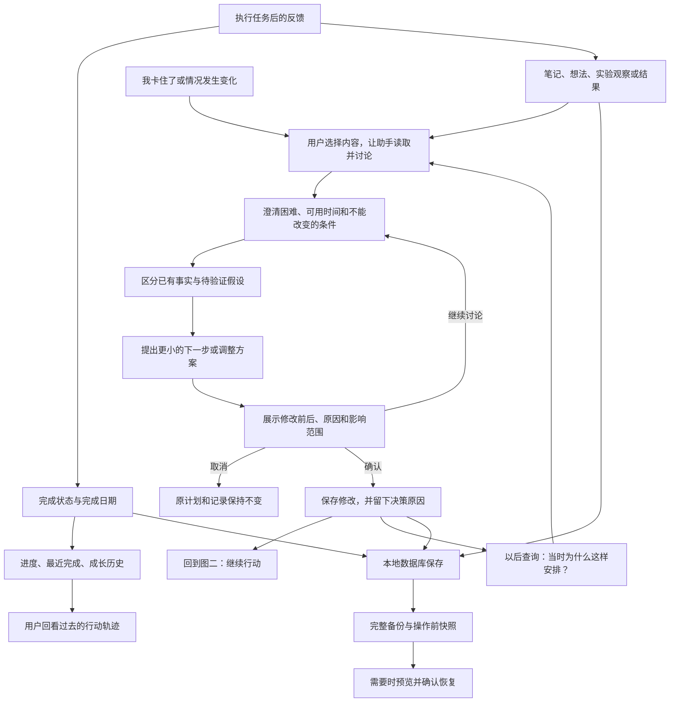

# 知行 Life Agent：从一句想法，到下一步行动

> 面向非程序员的产品介绍与路演稿 · 2026年10月29日
> 本文中的对话是演示脚本，不是已验证的真实模型回答。功能状态见文末。

## 一句话说清楚

知行是一个帮助人把模糊想法变成具体行动的个人生活助手。你不必先想清楚目标怎么拆、任务怎么写，只需要说出想法。它通过少量追问了解你的情况，再给出可以调整的安排。你确认以后，安排才进入你的事项和任务列表。

它服务日常生活：散步、准备考试、学习技能、安排分享、推进一个小项目。科研实验只是其中一种场景，不是产品的全部。

## 为什么需要它

很多时候，人并不是没有目标，而是不知道怎么开始。传统待办工具要求用户先想清楚，再逐条填写。聊天工具能给出建议，但建议容易留在对话里，和实际进度脱节。

知行希望把“想清楚”和“做下去”连接起来：理解想法、追问关键条件、形成计划、确认保存、记录进展、遇到困难时再调整。用户始终保留最后决定权。

## 用三张图看懂完整使用过程

整个产品分成三个连续环节：**把想法说清楚 → 把计划做下去 → 根据结果继续调整**。第一张图的终点，是第二张图的起点；第三张图把执行中的反馈带回下一轮行动。

### 图一：从一句想法，到一份确认过的行动方案

这一段解决“我想做，但还没想清楚”。用户不用先填写项目表格，助手根据事情大小追问必要信息。

只记下来的想法先留在收件箱，不会被强行展开成长期项目；以后用户需要时，再继续讨论和安排。

### 图二：有了行动方案，如何分解、提醒和勾选

这一段解决“今天具体做什么”。长期目标有完整路线，但首页只突出少量当前行动。提醒是一条辅助通道，是否处理提醒与是否完成任务是两件事。

- **任务与路线**：可以查看阶段、任务、子任务或完成条件，并在页面勾选。普通任务与学习任务的字段不同，不要求每种任务都拥有全部字段。
- **进度**：有任务时优先依据真实完成状态计算；部分子任务完成也会反映在对应进度中。
- **顺序**：可以在已有页面手动调整；目前助手尚不能自动调序或完成跨事项排期。
- **提醒**：助手可根据明确时间建议，用户在计划预览中修改或取消，确认后一起保存；也支持手动创建，标记“已处理”不会替用户勾选任务；稍后提醒也不会修改任务的截止日期。
- **边界**：关闭页面后不后台推送，重新打开时检查逾期提醒。手机系统通知仍是后续能力。

### 图三：执行以后，怎样留下成长轨迹并调整下一步

这一段解决“做过什么、为什么改、卡住后怎么办”。记录不是终点，而是下一次讨论的依据。

助手在用户发起讨论时读取所选内容，并非全天候自动监控。实验中的猜测应标记为“待验证假设”，不能写成已经完成的结论。每次确认的修改可以保留原因，用户以后能够回看目标是怎样一步步变化的。

完整备份包含任务状态、笔记、提醒、背景卡与决策记录；恢复是用户确认后的整体恢复。取消草案不会修改原数据，操作前快照则用于找回修改前的状态。

**路演时可以用三句话串起三张图：**

1. 第一张：你负责说出想法，助手帮你把它想清楚。
2. 第二张：计划不是留在聊天里，而是变成能查看、能提醒、能勾选的行动。
3. 第三张：做过的事情留下记录，遇到困难时有依据地调整，再继续推进。

## 场景一：我想去公园

用户：“我想去公园。”

助手应先问：“是今天想散散步，还是周末安排一次出游？”

用户：“今天，附近的，走走就行。”

助手再问：“你大概有多少时间？有没有已经选好的公园？”

得到条件后，提供简短的出门准备、散步和返程安排。不要询问专业、年级，也不要把一次散步拆成二十个任务。

当前没有地图、天气和开放时间查询工具，因此应把这些标成需要用户确认的信息，不能声称已经查到。后续接入真实工具后，再推荐具体路线。

**要表达的价值：小事轻量处理，问得少、问得对。**

## 场景二：我想准备考研

用户：“我想准备考研，不知道从哪开始。”

助手分轮了解年级、专业、报考年份、已有方向和可用时间。不要求一次填完长表格，不确定的地方允许保留。

第一份安排可以先做摸底、了解考试要求、确定资料范围，再根据实际结果细化阶段。首页只关注眼下最重要的几件事，而不是铺满未来一年的任务。

后来用户说：“最近课程太多。”助手应询问新的时间限制，解释哪些行动值得保留，提出修改草案。用户确认后保存调整原因。

**要表达的价值：计划可以随人变化，不是一张生成后就固定的课程表。**

## 场景三：任务拖了很久

提醒：“准备读书分享。开始时先列出三个想讲的观点。”

用户点击“我卡住了”，提醒内容进入助手输入框。助手先了解是没时间、不知道怎么做，还是任务太大，再提出一个十分钟可以开始的行动。

它不会因为用户没点提醒就自动判定失败，也不会擅自删除、推迟任务。

**要表达的价值：提醒之后还有帮助，而不只是催促。**

## 为什么称为 Agent

这里的模型负责理解和建议，程序负责保存规则和执行边界。系统读取授权范围内的记录，保留多轮讨论，输出结构化草案；后端检查目标、名称、归属和数据版本；用户确认后才通过本地数据库保存，再反馈结果。

这是一条受控工作流，而不是让模型直接改数据库。遇到信息不足时澄清；遇到数据冲突时拒绝旧草案；用户取消时不执行。

当前规划智能主要由模型提示与上下文支持，还不能宣称已实现可靠的自主排程算法。

## 三个值得强调的特点

1. **从意图开始**：用户无需先决定它属于项目、路线还是临时想法。
2. **按事情大小规划**：只记录、轻量安排、长期推进三种深度；不是所有事都变成项目。
3. **有依据地调整**：区分已有事实与待验证假设，保存确认过的调整原因，支持以后回顾。

个人背景卡由用户自愿填写，可修改或清空；只有明确勾选才随请求发送。系统不自动推测年龄、专业或生活状况。

## 数据和隐私，用普通话解释

事项、任务、进度、提醒、背景卡和决策记录保存在用户电脑的数据库。上传 GitHub 的是项目代码，不是个人数据库。

使用 AI 时，本次对话和所选内容会通过网络交给模型服务商；勾选背景卡时也会发送背景卡。语音识别可能使用浏览器厂商的网络服务。因此产品是“本地保存、按需联网”，不是“所有处理完全离线”。

## 三分钟路演讲稿

大家好，我们做的是知行 Life Agent，一个从一句想法开始的个人生活助手。

我们观察到，很多人缺的不是又一个待办清单，而是把想法变成行动的过程。你想学一门技能、准备考试，甚至只是周末出去走走，常常还没想清楚该问什么、先做什么，就要开始填项目和任务。

知行把这个顺序改变了。你先说一句想法，它根据事情的复杂程度提出必要问题。去公园，它关心时间和地点；准备考试，它才了解你的基础和阶段。你也可以说“先帮我记下来”，它不会强行生成一大堆安排。

接下来，助手提出方案和理由。所有新增、修改和删除都会先显示在预览里，用户确认才保存。真正开始行动后，任务进度、笔记和调整原因会留在控制台里。

我们尤其关注人卡住的时刻。提醒不应只是催促，而应该提供入口：告诉助手困难在哪里，一起找到一个足够小、今天能开始的行动。

我们的目标不是替用户决定生活，而是降低从想法到行动的门槛。数据保存在本地，AI 按需联网，用户保留确认权。

目前已完成本地控制台、确认式修改、决策记录和页面提醒等原型。后续重点验证真实模型的规划效果，逐步加入手机独立运行、系统通知和有约束的跨事项排程。

## 能力状态：申报和答辩必须讲清楚

| 能力 | 当前状态 |
|---|---|
| 事项、路线、实验、进度、笔记与备份 | 已实现 |
| 一句话想法入口、三种规划深度 | 已实现代码；真实模型效果待联调 |
| 多轮追问、轻重适配、最小行动建议 | 已接对话流程与模型约束；不是确定性效果保证 |
| 自愿背景卡与发送开关 | 已实现；不自动提取或推断背景 |
| 预览确认、版本冲突保护、决策原因保存 | 已实现 |
| 提醒设置、稍后15分钟、已处理、卡点入口 | 已实现页面内版本 |
| 手机窄屏界面 | 已适配；不是独立手机应用 |
| 手机后台通知、离线独立存储与设备同步 | 拟实现 |
| 天气、地图、网页或PDF检索 | 尚未接入 |
| 跨事项自动排期、严格时间预算和依赖校验 | 拟实现 |
| 真实模型质量评测 | 需要配置 API 密钥后进行 |

## 建议的演示验收

用“去公园”和“准备考研”检查是否提出相关问题、是否少问无关隐私。用“只记下来”检查是否只生成一条收件箱草案。用取消、确认和并发修改检查是否保护原数据。用一条明确实验观察检查是否把假设与事实分开。

不能用固定测试回复证明模型聪明；测试替身只能验证界面和保存链路。比赛材料可以展示完整愿景，但必须如实标注当前实现范围。
